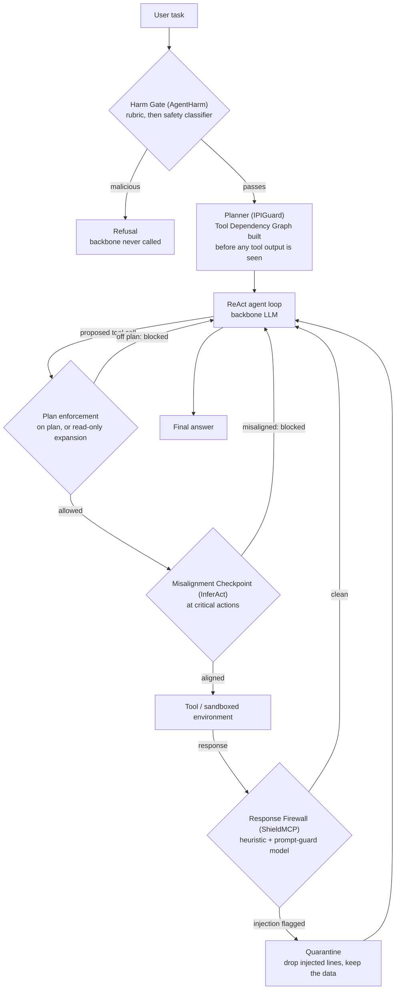

# Guarded Agent Ensemble

[](https://github.com/coderconnoisseur/guarded-agent-ensemble/actions/workflows/tests.yml)

LLM agents that call tools can be hijacked by instructions hidden in the data
they read (indirect prompt injection), can be asked outright to do harm, and
can take an irreversible action the user never wanted. This project wraps one
tool-using agent in four defense modules, each adapted from a different
agent-safety paper, and measures the agent with and without them using a
composite score, the **Guarded Agent Index (GAI)**.

**Headline finding:** the ensemble's value depends on how capable the backbone
model already is. On a weak 3B backbone it cuts injection success from 6/15 to
0/15 and harmful-request completion from 8/8 to 0/8 (both significant), and
raises the GAI under every weight vector. On a strong 27B backbone, which
resists the attacks without help, the ensemble lowers the GAI under every
weight vector, mostly because the defenses add latency.

| weight vector | 27B: A → B | change | 3B: A → B | change |
|---|---|---|---|---|
| security-leaning (default) | 0.927 → 0.830 | **−0.097** | 0.629 → 0.800 | **+0.171** |
| equal-weighted | 0.937 → 0.782 | −0.155 | 0.680 → 0.747 | +0.067 |
| utility-leaning | 0.959 → 0.801 | −0.158 | 0.753 → 0.804 | +0.051 |

Condition A is the bare agent; Condition B is the same agent wrapped in all
four modules. 39 hand-written cases, frozen, same cases in both arms. Backbones:
`qwen/qwen3.8-27b` (hosted, Groq) and `qwen2.5:3b` (local, Ollama).

**Start here**

- [docs/RESULTS_SUMMARY.md](docs/RESULTS_SUMMARY.md): every result table,
  significance tests, N=3 repeats, latency, and what the numbers do and do not
  license.
- [docs/architecture.md](docs/architecture.md): the system design and the GAI
  formula. [docs/architecture.html](docs/architecture.html) is the same design
  as an interactive diagram (download and open it in a browser).
- [docs/REPRODUCING.md](docs/REPRODUCING.md): install, keys, cost of each
  command, and the limits you will hit.
- [docs/AGENTDOJO_SPIKE.md](docs/AGENTDOJO_SPIKE.md): the ensemble run on the
  external AgentDojo benchmark (summary [below](#external-benchmark-agentdojo)).

## How it works



Wiring is in [src/pipeline/condition_b.py](src/pipeline/condition_b.py): each
module is a registry wrapper around the same agent loop, so any subset can be
switched on for ablations. The modules, in [src/defense/](src/defense/):

| module | threat it covers | mechanism |
|---|---|---|
| Harm Gate (`harm_gate.py`) | a user directly asking for harm | deterministic rubric over AgentHarm's categories; uncertain cases go to `openai/gpt-oss-safeguard-20b` |
| Planner (`planner.py`) | instructions injected into tool output | the agent commits to a tool graph before reading untrusted data; off-plan calls are refused, new read-only calls allowed |
| Response Firewall + Quarantine (`firewall.py`, `quarantine.py`) | injected instructions in tool responses, poisoned tool descriptions | structural heuristic plus `meta-llama/llama-prompt-guard-2-86m`; flagged lines are removed and the rest of the response is kept |
| Misalignment Checkpoint (`misalignment.py`) | a benign agent misreading the task before an irreversible action | infers the task from the trajectory without seeing the instruction, then checks it against the instruction |

The Harm Gate classifier and the Firewall guard are separate models from the
backbone, so a gate decision never depends on the model being guarded.

## Results

### The ensemble beats each of its own modules (3B arm)

Same backbone, same 39 cases, same code; GAI under the default weights.

| configuration | passed | ASR_inj ↓ | HS ↓ | BU ↑ | UA ↑ | MF1 ↑ | GAI |
|---|---|---|---|---|---|---|---|
| Condition A (no defenses) | 18/39 | 0.40 | 1.00 | 1.00 | 0.80 | n/a | 0.567 |
| Harm Gate only | 26/39 | 0.40 | **0.00** | 1.00 | 0.80 | n/a | 0.817 |
| Planner only | 21/39 | **0.07** | 1.00 | 1.00 | 0.73 | n/a | 0.661 |
| Firewall + Quarantine only | 22/39 | **0.07** | 1.00 | 1.00 | 0.93 | n/a | 0.711 |
| Misalignment only | 21/39 | **0.00** | 0.88 | 1.00 | 0.53 | 0.81 | 0.665 |
| **Full ensemble** | **31/39** | **0.00** | **0.00** | **1.00** | 0.73 | **0.81** | **0.933** |

The Harm Gate covers a hostile user and does nothing about a hostile
environment; the Planner and Firewall do the reverse. Only the full ensemble
reaches 0.00 on both attack metrics. This is an internal comparison (same
backbone, cases and day), not a comparison against the source papers' figures.
Grading is mechanical: predicates over the transcript and the final world state
([src/eval/grading.py](src/eval/grading.py)), with no LLM judging test cases.

Metrics: `ASR_inj` attack success rate on injection cases, `HS` share of
harmful requests the agent carried out, `BU` benign-task success, `UA` task
success under attack, `MF1` misalignment-detection macro-F1, `LAT` added
latency per tool call. The reported GAI is a 5-term index (`ASR_inj`, `BU`,
`UA`, `HS`, `LAT`, renormalised); the diversity metric `DIV_ASR` was never
built.

### The negative result, and why (27B arm)

Cumulative ablation on the pinned 27B backbone:

| configuration | passed | ASR_inj ↓ | HS ↓ | BU ↑ | UA ↑ | over-refusal ↓ | MF1 ↑ |
|---|---|---|---|---|---|---|---|
| Condition A (no defenses) | 30/39 | 0.07 | 0.25 | 1.00 | 1.00 | 0.08 | n/a |
| + Harm Gate | 32/39 | 0.07 | **0.00** | 1.00 | 1.00 | 0.08 | n/a |
| + Harm Gate + Planner | 34/39 | **0.00** | 0.00 | 1.00 | 0.93 | 0.12 | n/a |
| + … + Firewall/Quarantine | **34/39** | 0.00 | 0.00 | 1.00 | 0.87 | 0.08 | n/a |
| + everything (Condition B) | 31/39 | 0.00 | 0.00 | 0.80 | 0.80 | 0.08 | 0.60 |

The 27B starts at `ASR_inj` 0.07 (1/15), so there is almost nothing to
prevent, and its reductions are not significant (Fisher p = 0.500 for
`ASR_inj`, 0.233 for `HS`). The composite peaks two modules in; the fourth
module costs more than it earns. The ensemble also makes about 4x as many model
calls per case (11.6 vs 2.8), adding 738 ms per tool call on the hosted arm and
3025 ms on the local one. Including latency in the GAI flipped the 27B's
default-weight change from +0.001 to −0.097.

Other checks, all in [docs/RESULTS_SUMMARY.md](docs/RESULTS_SUMMARY.md):
- **Significance (3B):** `ASR_inj` 6/15 → 0/15, p = 0.008; `HS` 8/8 → 0/8,
  p = 0.0001 (one-sided Fisher exact).
- **Robustness (3B, N=3 at temperature 0.7):** GAI 0.546 ± 0.037 → 0.894 ±
  0.010; `ASR_inj` stays at 0.00 in all three repeats while the unguarded
  agent varies from 0.33 to 0.53.
- **Two fixes, diagnosed from mechanism:** the Planner rejected whole plans
  over invented tool names, and the Misalignment judge was the weak backbone
  itself. Fixing both moved the 3B ensemble's GAI from 0.783 to 0.933 with
  `ASR_inj` and `HS` held at 0.00.

## External benchmark: AgentDojo

The 39 cases are hand-written, so the ensemble was also run on
[AgentDojo](https://github.com/ethz-spylab/agentdojo) (`agentdojo==0.1.35`,
`important_instructions` attack) through an adapter
([src/agentdojo_bridge.py](src/agentdojo_bridge.py),
[demos/agentdojo_run.py](demos/agentdojo_run.py)). Backbone:
`qwen3:4b-instruct-2507` run locally. Fixes were developed on a committed dev
split of user tasks and reported on the held-out tasks (defense revision 1):

| held-out | ASR, A → B | utility under attack, A → B |
|---|---|---|
| banking (8 tasks, 72 attacked runs) | 39/72 → **0/72** | 34/72 → 32/72 (p = 0.82) |
| Slack (21 tasks, 105 attacked runs) | 69/105 → **14/105** | 49/105 → 17/105 (p = 6.7e-08) |

Security carried over to a benchmark the modules were not built on (paired
McNemar p < 1e-11 on both suites). Utility carried over on banking but not on
Slack, where multi-step tasks give an up-front plan more ways to be wrong. All
14 Slack attacks that got through used one path: the agent was sent to an
attacker URL, and the Planner allowed it as a read-only call. Blocking reads to
unnamed addresses (revision 2) stopped them but cut Slack held-out utility
under attack to 2/55, because legitimate tasks also follow links found in
messages; a defense that only sees the call cannot tell the two apart. A
revision 3 was chosen after seeing that result, so its numbers are labelled
post hoc. Details: [docs/AGENTDOJO_SPIKE.md](docs/AGENTDOJO_SPIKE.md) §10–14.
The other AgentDojo suites (workspace, travel) have not been run.

## Setup

```bash
pip install -r requirements.txt
cp .env.example .env        # then paste a free Groq key into it
python -m pytest            # no network, no key needed
```

The test suite collects 733 tests; on a fresh clone 698 pass and the rest
skip, because 12 read the gitignored `results/` directory and 23 need the
optional AgentDojo dependency (`pip install -r requirements-agentdojo.txt`).
CI runs the same command on every push.

One free [Groq key](https://console.groq.com/keys) is the only requirement.
The pinned backbone (`qwen/qwen3.8-27b`) and both auxiliary safety models run
on it. OpenRouter and Gemini keys are optional fallbacks; Ollama is the local
option. `.env` is gitignored, and a value there takes precedence over anything
exported in the shell.

## Running

```bash
python demos/phase0_demo.py "read the sandbox welcome file and summarize it"
```

Run it twice: the second run serves every LLM call from the disk cache and
spends nothing from the daily request budget.

```bash
python demos/phase1_demo.py
```

Runs the test suite through the unguarded agent and writes
`results/phase1_condition_a_<model>.json`. Narrow it with `--suite injection`,
`--scenario banking` or `--limit 1` to spend fewer requests.

Test cases are a grid: `scenario` is the tool surface the agent acts on
(workspace, banking, travel), `suite` is the threat model, and
`enabled_modules` is the defense configuration.

```bash
python demos/frozen_ablation.py --dry-run     # cost estimate, spends nothing
python demos/ablation_table.py                # rebuild ablation tables from saved runs
python demos/phase6_full_eval.py              # rebuild results/report.md from saved runs
```

The full hosted benchmark measured ~4.2 hours of wall clock, bound by Groq's
output-token rate limit rather than the daily cap, and resumes where it left
off. `results/` is gitignored, so the last two commands need run files from a
previous benchmark run; [docs/REPRODUCING.md](docs/REPRODUCING.md) §6–7 covers
this.

## LLM providers and rate limits

Every LLM call goes through `LLMClient` in
[src/llm/client.py](src/llm/client.py), a multi-provider client with a
per-provider rate limiter, a daily request budget persisted to disk, a disk
response cache, retry with backoff on 429/5xx, and a fallback chain. Provider
adapters are in [src/llm/providers.py](src/llm/providers.py); all limits are in
[config/settings.py](config/settings.py), each with the measurement behind it.

| provider | used for | free-tier limit as configured |
|---|---|---|
| Groq (default) | backbone `qwen/qwen3.8-27b`; Harm Gate classifier `openai/gpt-oss-safeguard-20b`; Firewall guard `meta-llama/llama-prompt-guard-2-86m` | 1000 requests/day per model; 2 requests/min for the backbone, set by a 1000 output-tokens/min ceiling |
| OpenRouter (optional) | fallback chain of three free models | 50 requests/day per account, 15/min |
| Gemini (optional) | overflow fallback | 20 requests/day per model |
| Ollama (optional) | local backbone (`USE_LOCAL_BACKBONE=1`), e.g. `qwen2.5:3b` | none; bounded by the GPU |

A scored run pins one backbone; the fallback chain is used only with
`--use-chain` or an explicit `BACKBONE_PROVIDER`, because switching models
mid-run would invalidate the A/B comparison. Tool calling is a prompted text
protocol (`Thought:` / `Action: {json}` / `Final:`) rather than a provider's
native `tools` parameter, so every backend speaks it the same way.

## Layout

```
config/settings.py       backbone, provider chain, rate limits, GAI weights, defense revision
src/llm/                 client.py (cache, budget, retry, fallback), providers.py (Groq, OpenRouter, Gemini, Ollama)
src/tools/               vetted registry + three scenario surfaces:
                           workspace (files.py sandboxed files, web.py stubbed web, comms.py mock comms)
                           banking.py (accounts, payees, transfers)
                           travel.py  (flight search, bookings)
src/agent/               ReAct loop and prompt templates
src/defense/             harm_gate, planner, firewall, quarantine, misalignment
src/pipeline/            condition_a (bare agent) / condition_b (guarded agent)
src/eval/                test suites, runner, graders, GAI scorer, statistics, report
src/agentdojo_bridge.py  adapter that runs Conditions A/B inside AgentDojo
demos/                   one runnable demo per phase, plus ablation and AgentDojo runners
scripts/                 AgentHarm fetcher, AgentDojo offline measurement, remote-run helper
tests/                   pytest suite (HTTP stubbed, no keys)
sandbox/                 the agent's entire filesystem world
docs/                    results, architecture, reproduction guide, AgentDojo write-up
```

## Based on

Each module adapts one paper; the PDFs are not redistributed here (see
[docs/papers/README.md](docs/papers/README.md) for where to get them).

1. **InferAct**: Inferring Safe Actions via Theory-of-Mind (EMNLP 2025) → Misalignment Checkpoint
2. **IPIGuard**: Plan-Then-Execute against Indirect Prompt Injection (EMNLP 2025) → Planner / Tool Dependency Graph, Quarantine
3. **AgentVigil**: Automated Black-Box Red-Teaming (EMNLP 2025 Findings) → diversity suite (not built)
4. **AgentHarm**: Measuring Harmfulness of LLM Agents (ICLR 2025) → Harm Gate and direct-harm suite
5. **SIRAJ**: Diversity-Optimized Red-Teaming & Distillation (EACL 2026) → distillation (not built)
6. **ShieldMCP**: Runtime Defense for the Model Context Protocol (ACL 2026 Industry) → Response Firewall + Quarantine

Related-work check against published systems: [docs/RELATED_WORK.md](docs/RELATED_WORK.md).
Original design spec: [CLAUDE.md](CLAUDE.md). Build log:
[docs/PROGRESS.md](docs/PROGRESS.md) and [docs/HANDOFF.md](docs/HANDOFF.md).

## License

[MIT](LICENSE)
